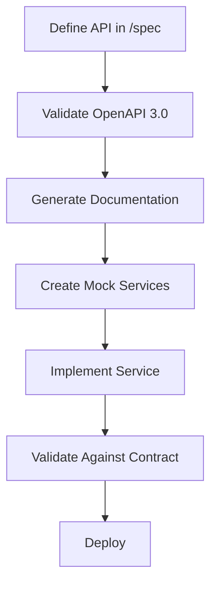

# 🎫 Project Biometal - Ticket Handling Guide

## 🎯 Overview

This guide establishes the **specification-driven development workflow** for Project Biometal/FuncOS, emphasizing that **all development starts from `/spec`** and flows systematically to other components following WebAXP conventions.

## 🌊 Development Flow Principle

> **Everything starts with API. `/spec` contains the seed of all other subsystems.**

### **Core Development Flow**
```
/spec → /docs → /app → /build → /dist
  ↓       ↓       ↓       ↓       ↓
 API   Docs   Code   Build   Deploy
```

**Critical**: Development **MUST** begin with API specifications in `/spec` before any implementation work begins.

## 📋 Ticket Lifecycle

### **1. Ticket Creation**
- **Location**: `/project/next/YYYYMMDD-{component}-ticket.md`
- **Status**: 🟢 READY TO START
- **Format**: Structured markdown with clear objectives and deliverables

### **2. Ticket Assignment**
- Agent claims ticket by updating **Assignee** field
- Status remains 🟢 READY TO START until work begins
- Agent creates feature branch: `feature/{component}-{description}`

### **3. Specification-First Development**

#### **Phase 1: API Specification** (REQUIRED FIRST)
```bash
# 1. Define APIs in /spec
/spec/api/{component}.yaml          # OpenAPI 3.0 specification
/spec/systems/{target}.yaml         # Target-specific implementations

# 2. Validate specifications
./develop/scripts/validate-api-specs-docker.sh

# 3. Generate documentation
./develop/scripts/generate-api-docs.sh --format html
```

#### **Phase 2: Documentation Generation**
```bash
# Auto-generate from specifications
/docs/api/{component}/              # API documentation
/docs/systems/{target}/             # System-specific guides
```

#### **Phase 3: Application Scaffolding**
```bash
# Generate from API specs
/app/src/{component}/               # Source code scaffolding
/app/environment/                   # Development environment
```

#### **Phase 4: Build Configuration**
```bash
# Generate from system specs
/build/targets/{target}/            # Target-specific builds
/build/environment/                 # Build environment
```

#### **Phase 5: Distribution**
```bash
# Generate from build specs
/dist/packages/{target}/            # Built artifacts
/dist/environment/                  # Testing environment
```

### **4. Ticket Progress Tracking**

#### **Status Updates**
- 🟢 **READY TO START** - Ticket created, awaiting assignment
- 🟡 **IN PROGRESS** - Agent actively working
- 🔵 **REVIEW** - Pull request created, awaiting review
- ✅ **COMPLETED** - Merged and validated
- ❌ **BLOCKED** - Waiting on dependencies

#### **Required Updates**
```markdown
**Status**: ✅ COMPLETED
**Assignee**: {Agent Name}
**Completed By**: {Agent Name}
**Completion Date**: YYYY-MM-DD
**Pull Request**: #{PR_NUMBER}
```

### **5. Completion Requirements**

#### **Deliverables Checklist**
- [ ] API specifications created/updated in `/spec`
- [ ] All specifications validated (OpenAPI 3.0 compliant)
- [ ] Documentation generated and verified
- [ ] Integration contracts defined
- [ ] Pull request created with comprehensive description
- [ ] All tests passing
- [ ] Ticket status updated to COMPLETED

#### **Quality Gates**
- ✅ **Specification Validation**: All APIs must pass OpenAPI validation
- ✅ **Documentation Generation**: Must auto-generate from specs
- ✅ **Integration Contracts**: Clear interfaces for dependent teams
- ✅ **WebAXP Compliance**: Follow established conventions
- ✅ **Zero Breaking Changes**: Maintain backward compatibility

## 🔄 Specification-Driven Workflow

### **1. API-First Development**


### **2. Cross-Team Integration**
- **Service Contracts**: Defined in `/spec/api/`
- **System Targets**: Defined in `/spec/systems/`
- **Integration Points**: Documented in API specifications
- **Mock Services**: Generated from specifications for testing

### **3. Validation Pipeline**
```bash
# Required for every change
./develop/scripts/validate-api-specs-docker.sh
./develop/scripts/generate-api-docs.sh
docker-compose run --rm test
```

## 🎯 Ticket Templates

### **Component Development Ticket**
```markdown
# 🎫 TICKET: {Component Name}

**Ticket ID**: YYYYMMDD-{component}
**Project**: {Component-Name}
**Status**: 🟢 READY TO START
**Priority**: {HIGH|MEDIUM|LOW}
**Assignee**: {Team/Agent}

### Objectives
- [ ] Define API specifications in /spec
- [ ] Implement core functionality
- [ ] Establish integration contracts
- [ ] Enable parallel development

### Prerequisites
- Understanding of WebAXP conventions
- API-first development methodology
- Component architecture knowledge

### Deliverables
1. **API Specifications** (`/spec/api/{component}.yaml`)
2. **System Specifications** (`/spec/systems/{target}.yaml`)
3. **Implementation** (`/app/src/{component}/`)
4. **Documentation** (auto-generated from specs)
5. **Integration Tests** (contract validation)

### Success Criteria
- [ ] All APIs OpenAPI 3.0 compliant
- [ ] Documentation auto-generated
- [ ] Integration contracts defined
- [ ] Other teams can proceed with development
```

## 📊 Project Status Tracking

### **Ticket Status Dashboard**
```
📋 TICKETS OVERVIEW
├── 🟢 READY TO START: {count}
├── 🟡 IN PROGRESS: {count}
├── 🔵 REVIEW: {count}
├── ✅ COMPLETED: {count}
└── ❌ BLOCKED: {count}
```

### **Component Progress Matrix**
| Component | API Spec | Implementation | Integration | Status |
|-----------|----------|----------------|-------------|---------|
| API-Specifications | ✅ | ✅ | ✅ | COMPLETED |
| ZealOS-Integration | 🟢 | ⏳ | ⏳ | READY |
| FuncOS-Core | ⏳ | ⏳ | ⏳ | PENDING |
| Function-Execution | ⏳ | ⏳ | ⏳ | PENDING |
| Neural-Data-Interface | ⏳ | ⏳ | ⏳ | PENDING |
| Browser-Network-API | ⏳ | ⏳ | ⏳ | PENDING |

## 🚀 Next Agent Handoff

### **For Incoming Agents**
1. **Review completed tickets** in `/project/next/`
2. **Check API specifications** in `/spec/api/`
3. **Understand integration contracts** from API docs
4. **Use validation tools** before starting development
5. **Follow specification-first workflow**

### **Critical Success Factors**
- **Start with `/spec`** - Never begin with implementation
- **Validate early and often** - Use provided tools
- **Generate documentation** - Keep specs and docs in sync
- **Define integration contracts** - Enable parallel development
- **Follow WebAXP conventions** - Maintain consistency

## 🔗 Integration with Other Teams

### **API Contracts as Source of Truth**
- All inter-service communication defined in `/spec/api/`
- Mock services generated from specifications
- Contract testing ensures implementation compliance
- Documentation auto-generated from specifications

### **Parallel Development Enablement**
- Teams can work simultaneously using API contracts
- Mock services provide immediate integration testing
- Clear boundaries prevent development conflicts
- Consistent patterns reduce integration complexity

---

**Remember**: In Project Biometal, **development flows from specification to implementation**, ensuring consistency, quality, and enabling efficient parallel development across all teams.
